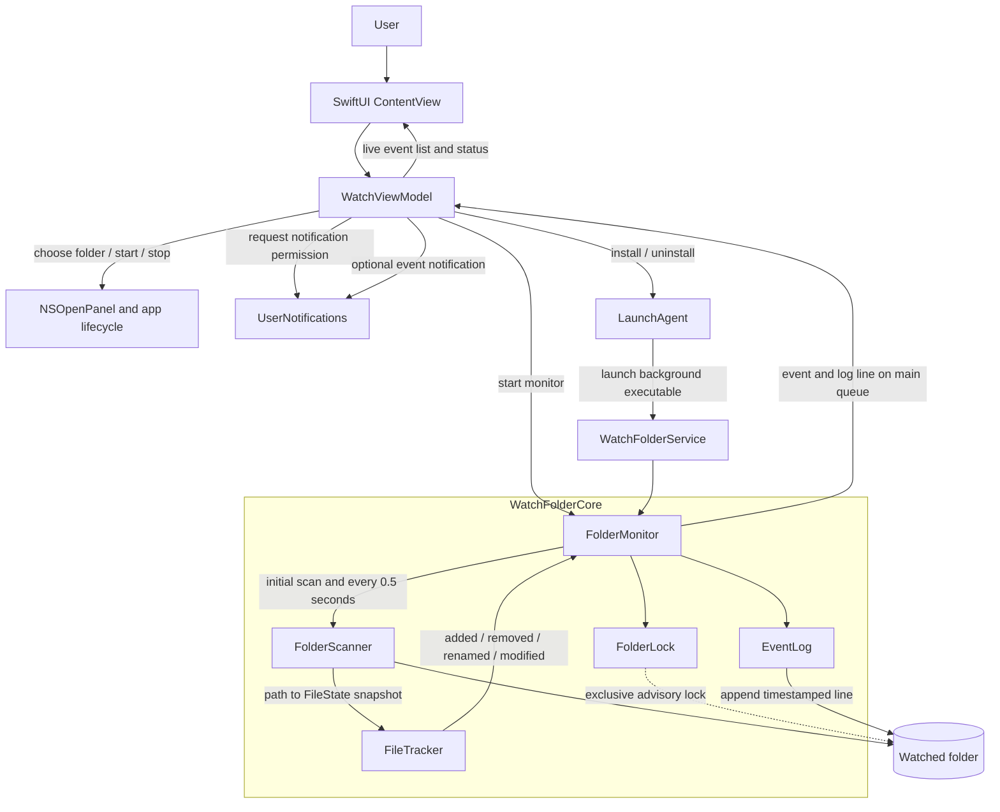

# Architecture

WatchFolder separates the macOS interface from the reusable monitoring core. The core takes filesystem snapshots on a background queue, diffs each snapshot against the previous one, and persists detected events before notifying the interface.

## Components and event flow

## Responsibilities

| Component | Responsibility |
| --- | --- |
| `ContentView` | Presents folder selection, watch controls, status, errors, and the live event list. |
| `WatchViewModel` | Owns UI state and the monitor lifecycle; requests notification authorization, posts notifications when enabled, and manages the background service. |
| `WatchFolderService` | Runs the folder monitor and event notifications in a separate process while the app window is closed. |
| `ServiceManager` | Installs and removes the per-user LaunchAgent and its private app-bundle copy. |
| `FolderMonitor` | Validates and starts a watch, schedules scans on a serial dispatch queue, writes events, and delivers callbacks on the main queue. |
| `FolderScanner` | Recursively snapshots regular files and ordinary directories using relative paths, device/inode identity, size, and modification time. Packages are treated as atomic entries. |
| `FileTracker` | Diffs two snapshots, pairs removed and added paths with matching identity as renames, and detects modifications at unchanged paths. |
| `FolderLock` | Holds a non-blocking exclusive `flock(2)` lock so a second instance cannot monitor the same folder concurrently. |
| `EventLog` | Appends timestamped, human-readable event lines to `watchfolder.log`. |

## Monitoring lifecycle

1. The user selects a folder. Its path is stored in `UserDefaults` and restored on the next launch.
2. On start, the app requests notification permission if needed. Regardless of notification availability, it attempts to start monitoring.
3. `FolderMonitor` validates the directory, acquires `.watchfolder.lock`, prepares the log, and captures an initial snapshot. The initial contents are the baseline, not a batch of added events.
4. Every 0.5 seconds, the monitor scans again and compares the new snapshot with the previous one.
5. Each detected event is appended to the log. Event callbacks are dispatched to the main queue for the UI and, if authorized, a user notification.
6. On stop or scan/log failure, the timer is cancelled and the folder lock is released. Errors are surfaced to the UI.
7. Installing the LaunchAgent starts a separate monitor for the selected folder and closes the GUI after confirmation. The agent is not configured to restart monitoring automatically at login.

## Change detection notes

- A file state uses filesystem device and inode identity plus size and modification time.
- A path removed from one snapshot and added at another path with the same identity is reported as a rename. If the path remains but its state changes, the event is modified.
- Removed nested paths are reported before their parent directory; additions are reported parent-first.
- The scanner does not descend into package directories, including `.app` bundles.
- The watcher ignores its root-level log and lock files, `.DS_Store`, and `._*` entries. Polling means changes that appear and disappear between scans can be missed.
